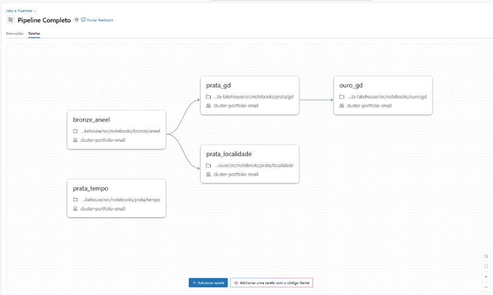

# ⚡ Enterprise Data Lakehouse — Inteligência Regulatória & Geração Distribuída (ANEEL)

[](https://www.python.org/)
[](https://www.databricks.com/)
[](https://spark.apache.org/)
[](https://www.getdbt.com/)
[](https://delta.io/)
[](https://azure.microsoft.com/)
[-0062AD?logo=azurefunctions&logoColor=white)](https://learn.microsoft.com/azure/azure-functions/)
[](https://powerbi.microsoft.com/)

Plataforma end-to-end de **Engenharia de Dados e Analytics** construída sob os padrões **Lakehouse** e **Arquitetura Medalhão (Bronze, Prata e Ouro)**. O projeto ingere, trata, modela e disponibiliza dados públicos e regulatórios do setor elétrico brasileiro (**Geração Distribuída — ANEEL**), culminando em um modelo dimensional otimizado (*Star Schema*) e dashboards executivos no Power BI.

---

## ⚙️ Como o Projeto Funciona (Fluxo End-to-End)

O pipeline foi desenhado sob o princípio de **desacoplamento total entre orquestração, extração, transformação e governança**. Nenhum notebook contém lógica de negócio solta; todos atuam como pontos de entrada (*entrypoints*) leves que acionam módulos Python estruturados, micro-serviços Serverless e modelos SQL no dbt.

### 1. Orquestração: Databricks Workflows (`Pipeline Completo`)

A execução é gerenciada por um **Databricks Job (DAG)**, onde cada *task* aponta diretamente para um notebook orquestrador no repositório Git:



* **Dependências entre Tasks:**
  * `bronze_aneel` executa a ingestão bruta a partir da fonte externa.
  * Assim que `bronze_aneel` finaliza com sucesso, as tasks **`prata_gd`** e **`prata_localidade`** são disparadas em paralelo.
  * Paralelamente e de forma independente (pois não depende da extração da ANEEL), **`prata_tempo`** constrói/atualiza a dimensão calendário (`dim_calendario`).
  * Após a conclusão de `prata_gd`, a task **`ouro_gd`** é acionada para construir o *Star Schema* final.

---

### 2. Extração e Carga na Camada Bronze (Python OOP + Azure Function `Brazil South` + ADLS + Delta)

A ingestão da camada **Bronze** não utiliza código procedural em células de notebook e resolve de forma **100% cloud-native** o bloqueio geográfico (*Geo-Block*) imposto pelo portal da ANEEL a datacenters fora do Brasil. Quando a task `bronze_aneel` é acionada, o fluxo segue a seguinte cadeia:

1. **Entrypoint (`src/notebooks/bronze/aneel.py`):** Utiliza o contrato `BaseNotebook` (`src/notebooks/base_notebook.py`), que padroniza o ciclo de vida de execução, validação de dependências (`requirements.txt`), resolução de ambiente (`DatabricksRuntime`) e leitura dinâmica de parâmetros (`modo_carga`: `full`/`incremental` e `tabela_alvo`).
2. **Orquestração de Extração (`AneelGdExtractor`):** Implementa o contrato de `BaseExtractor` (`src/ingestion/base_extractor.py`). Para manter o baixo custo do compute Databricks em `East US 2` (EUA) sem sofrer bloqueio de IP no portal `dadosabertos.aneel.gov.br`, o extrator recupera a URL autenticada da Function no **Azure Key Vault (`kv-portfolio-igor` / Secret Scope `kv-portfolio-scope`)** e aciona obrigatoriamente o micro-serviço Serverless no Brasil.
3. **Micro-Serviço Serverless em `Brazil South` (`azure_functions/aneel_landing_br/`):** A Azure Function **`func-lakehouse-ingestao-br`** (hospedada em São Paulo com IP brasileiro) baixa o `.parquet` oficial da ANEEL (`~103 MB`) via streaming em blocos de `1 MB` e o transfere via REST API (`SharedKey HMAC-SHA256`) em blocos de `4 MB` (`Put Block` + `Put Block List`), sobrescrevendo o arquivo único na Landing Zone do **Azure Data Lake Storage Gen2** (`landing/aneel_gd/empreendimento-geracao-distribuida.parquet`). Se a comunicação com a ANEEL falhar, a execução é interrompida imediatamente, impedindo "atualizações falsas" com dados antigos.
4. **Governança, Escrita e Limpeza Transitória (`DeltaCatalogManager` + `AdlsStorageConnector` + `catalog_dictionary.py`):** O Spark lê o arquivo recém-sincronizado na Landing Zone, injeta metadados de auditoria (`_ingestion_at`, `_source_name`), consulta o **Single Source of Truth (SSOT)** definido em `src/catalog_dictionary.py` e grava/atualiza (`Overwrite` ou `MERGE INTO`) a tabela Delta no **Unity Catalog** (`portfolio-lakehouse-bronze.aneel.aneel_gd_empreendimentos`) com transações ACID. Logo após a persistência Delta, o padrão **Transient Landing Zone** exclui automaticamente a pasta temporária `landing/` do ADLS Gen2, eliminando armazenamento duplicado.

---

### 3. Transformação nas Camadas Prata e Ouro (dbt Core + Databricks)

As camadas **Prata** e **Ouro** são implementadas 100% em SQL modular utilizando **dbt Core** (`dbt_project/`). Para integrar o dbt nativamente dentro das tasks do Databricks Workflows sem depender de orquestradores externos:

1. **Ponte Python → dbt (`DbtRunner`):** Os notebooks de Prata (`gd.py`, `localidade.py`, `tempo.py`) e Ouro (`gd.py`) invocam a classe `DbtRunner` (`src/infrastructure/dbt_runner.py`). Essa classe auto-descobre e injeta dinamicamente as credenciais/tokens do compute Databricks e dispara os comandos `dbt run` com seletores específicos das tabelas de cada domínio.
2. **Roteamento Dinâmico de Schemas (`generate_schema_name.sql`):** Macro customizada do dbt que garante que cada pasta de modelo materialize exatamente no schema correspondente do Unity Catalog (`gd`, `localidade`, `tempo`), evitando prefixos duplicados.
3. **Camada Prata (Limpeza, Tipagem e Conformidade — `portfolio-lakehouse-prata`):**
   * Deduplicação de registros históricos (`QUALIFY ROW_NUMBER()`), tratamento de valores nulos, anonimização LGPD, padronização de strings/UFs e tipagem forte (`DECIMAL`, `DATE`, `BIGINT`).
   * Criação das dimensões conformadas (`dim_distribuidoras`, `dim_classes_consumo`, `dim_regioes`, `dim_ufs`, `dim_municipios`, `dim_localidade`, `dim_calendario`) e da tabela base `fato_empreendimentos_prata`.
4. **Camada Ouro (Modelagem Dimensional Star Schema — `portfolio-lakehouse-ouro`):**
   * Geração de chaves substitutas (*Surrogate Keys*) determinísticas via **`XXHASH64`** para otimizar joins e maximizar a compressão colunar no motor VertiPaq do Power BI.
   * Materialização da **`fato_empreendimentos`** conectada às dimensões de negócio (`dim_titular`, `dim_tecnologia`, `dim_modalidade`, `dim_enquadramento`).
5. **Data Quality Gates (`dbt test`):**
   * Arquivos `_models.yml` validam automaticamente unicidade de chaves primárias (`unique`), ausência de nulos (`not_null`) e integridade referencial (`relationships`) antes de liberar os dados para consumo.

---

## 📂 Estrutura do Repositório

```text
enterprise-data-lakehouse/
├── azure_functions/                    # Micro-serviço Serverless em Brazil South (contorno de Geo-Block)
│   └── aneel_landing_br/
│       ├── function_app.py             # Endpoint POST 'sync_aneel_landing' (streaming 1MB -> ADLS 4MB)
│       ├── host.json                   # Timeout configurado para 10 minutos ("00:10:00")
│       ├── requirements.txt            # Dependências da Function (azure-functions, requests)
│       └── .funcignore
├── dbt_project/                        # Transformações SQL, testes e documentação (Prata & Ouro)
│   ├── macros/
│   │   └── generate_schema_name.sql    # Roteamento dinâmico de schemas no Unity Catalog
│   ├── models/
│   │   ├── bronze/aneel/               # Definição de sources (_bronze_aneel__sources.yml)
│   │   ├── prata/                      # Modelos cleansed e dimensões conformadas (gd, localidade, tempo)
│   │   └── ouro/gd/                    # Star Schema final (fato_empreendimentos e dimensões)
│   ├── dbt_project.yml
│   └── profiles.yml
├── docs/
│   └── images/
│       └── workflow_databricks.png     # Arquitetura visual da DAG no Databricks Workflows
├── power_bi/                           # Relatórios e Modelos Semânticos versionados (Analytics as Code)
│   └── mercado_gd_de_energia_solar/
│       ├── Mercado de GD de Energia Solar.Report/
│       ├── Mercado de GD de Energia Solar.SemanticModel/  # Definições TMDL, medidas DAX e relacionamentos
│       └── Mercado de GD de Energia Solar.pbip
├── src/                                # Core de Engenharia de Dados em Python (OOP / Clean Code)
│   ├── connectors/
│   │   └── adls_storage_connector.py   # Upload REST SharedKey (HMAC-SHA256) em blocos de 4 MB no ADLS Gen2
│   ├── infrastructure/
│   │   ├── databricks_runtime.py       # Abstração de SparkSession, validação do requirements.txt e credenciais
│   │   └── dbt_runner.py               # Executor programático do dbt Core dentro do Databricks
│   ├── ingestion/
│   │   ├── base_extractor.py           # Contrato abstrato para extratores de dados
│   │   └── extractors/
│   │       └── aneel_gd_extractor.py   # Extrator da ANEEL integrado à Azure Function em Brazil South
│   ├── notebooks/                      # Entrypoints acionados pelas tasks do Databricks Workflow
│   │   ├── base_notebook.py            # Contrato base para padronização de widgets, validação e execução
│   │   ├── bronze/aneel.py             # Task: bronze_aneel
│   │   ├── prata/                      # Tasks: prata_gd, prata_localidade, prata_tempo
│   │   └── ouro/gd.py                  # Task: ouro_gd
│   ├── persistence/
│   │   └── delta_catalog_manager.py    # Persistência Delta ACID e governança no Unity Catalog
│   ├── catalog_dictionary.py           # Single Source of Truth (SSOT) de tabelas e schemas
│   └── config.py                       # Gestão centralizada de variáveis (.env) e Azure Key Vault
├── tests/                              # Suíte de testes automatizados (Pytest)
│   ├── unit/                           # Testes unitários (configurações, contratos e extratores)
│   └── integration/                    # Testes de integração de conexões e storage
├── pytest.ini
└── requirements.txt
```

---

## 🛠️ Boas Práticas de Engenharia Aplicadas

* **Clean Code & SOLID (SRP):** Separação estrita de responsabilidades entre infraestrutura de runtime (`DatabricksRuntime`, `DbtRunner`), conectividade de storage (`AdlsStorageConnector`), persistência Delta/Catálogo (`DeltaCatalogManager`), extração (`BaseExtractor`, `AneelGdExtractor`) e contrato de execução (`BaseNotebook`).
* **Single Source of Truth (SSOT):** Centralização dos metadados de tabelas, chaves primárias e schemas em `src/catalog_dictionary.py`, alimentando dinamicamente tanto os seletores de carga quanto os *Widgets* dos notebooks.
* **FinOps & Arquitetura Multi-Região (`East US 2` + `Brazil South`):** Combina o menor custo de computação do Azure Databricks e ADLS Gen2 em `East US 2` com uma Azure Function Serverless em `Brazil South` acionada sob demanda para contornar restrições geográficas governamentais sem custo ocioso.
* **Segurança Cloud-Native (`Azure Key Vault`):** Credenciais de armazenamento (`adls-storage-key`) e chaves de endpoints (`aneel-br-function-url`) gerenciadas no **Azure Key Vault (`kv-portfolio-igor`)** e integradas via **Databricks Secret Scope (`kv-portfolio-scope`)**.
* **Testes Automatizados (`Pytest`):** Cobertura de testes unitários (`tests/unit/`) e testes de integração (`tests/integration/`) validando configurações, contratos de extração, obrigatoriedade de sincronização e conectividade com Azure/Databricks.
* **BI Versionado (Analytics as Code):** Projeto Power BI salvo em `.pbip` com metadados semânticos em **TMDL**, permitindo controle de versão via Git de medidas DAX, relacionamentos e visuais.

---

## 🚀 Como Executar Localmente ou no Databricks

### 1. Configuração do Ambiente Local

```bash
git clone https://github.com/Igor12x/enterprise-data-lakehouse.git
cd enterprise-data-lakehouse

python -m venv .venv
source .venv/bin/activate  # Linux/Mac
# .venv\Scripts\activate   # Windows

pip install -r requirements.txt
```

### 2. Executar Suíte de Testes (Pytest)

```bash
python -m pytest -v tests/unit/
```

### 3. Publicar a Azure Function de Ingestão (`Brazil South`)

```bash
cd azure_functions/aneel_landing_br
func azure functionapp publish func-lakehouse-ingestao-br
```

### 4. Executar Modelos e Testes dbt via CLI

```bash
cd dbt_project
dbt debug --profiles-dir .
dbt run --profiles-dir .
dbt test --profiles-dir .
```

### 5. Execução Orquestrada no Databricks

No Databricks Workflows, o job **`Pipeline Completo`** executa automaticamente toda a árvore de dependências, acionando sequencialmente a ingestão na camada Bronze (`bronze_aneel` ➔ Azure Function `Brazil South` ➔ ADLS Gen2 ➔ Delta Lake), as transformações paralelas via `DbtRunner` (`prata_gd`, `prata_localidade`, `prata_tempo`) e a consolidação dimensional (`ouro_gd`).

---

## 👨‍💻 Autor

**Igor Barroca Tenório**

*Data & Business Intelligence Analyst | Data Engineering*
